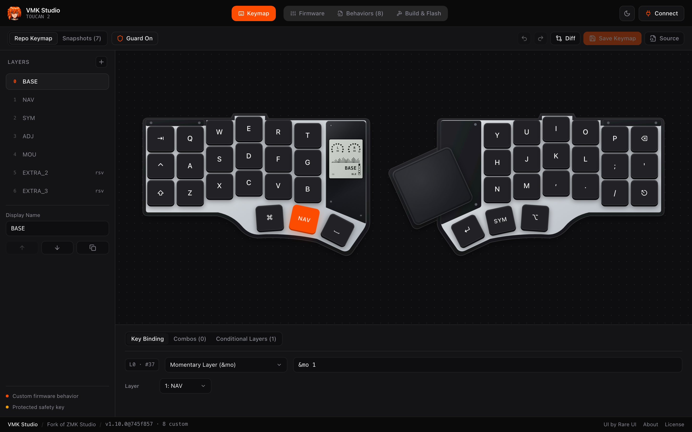

<div align="center">
  <picture>
    <source media="(prefers-color-scheme: dark)" srcset="docs/assets/logo-dark.png" />
    <source media="(prefers-color-scheme: light)" srcset="docs/assets/logo-light.png" />
    
  </picture>

  <p>
    <strong>VMK Studio</strong> is a dedicated desktop and web Studio app built specifically for the <strong>beekeeb Toucan 2</strong> split keyboard, forked from <a href="https://github.com/zmkfirmware/zmk-studio">ZMK Studio</a>.
  </p>

  <picture>
    <source media="(prefers-color-scheme: dark)" srcset="docs/assets/screenshot-dark.png" />
    <source media="(prefers-color-scheme: light)" srcset="docs/assets/screenshot-light.png" />
    
  </picture>
</div>

<br />

Its purpose is to bring **QMK-grade features and customisability** onto **ZMK** — and make day-to-day keymap, firmware, display, and trackpad tuning effortless on Toucan 2 without stock ZMK Studio overwriting custom behaviours.

## Why VMK Studio (QMK features on ZMK, tailored for Toucan 2)

Stock ZMK Studio only understands standard upstream behaviours and lacks first-class controls for custom firmware modules. VMK Studio bridges the gap between QMK power-user workflows and wireless ZMK hardware:

- **QMK Features Brought to ZMK**:
  - **QMK Release-Based Quick-Tap (`QUICK_TAP_TERM`)**: Direct tuning of `&mt` / `&lt` `quick-tap-ms`, `tapping-term-ms`, and Hold-Tap `flavor`.
  - **Per-Endpoint Ctrl↔GUI Swap (`CG_TOGG` parity)**: Dedicated inspector and Kconfig controls for `cg_toggle/endpoints` (`src/cg_toggle.c`), which remembers an independent Ctrl↔GUI swap state per USB and BLE profile (`BLE 0`–`BLE 4`) so switching devices applies the target host's mapping automatically — together with OS-aware Pinch Zoom, Smart Zoom, and Browser Back/Forward.
  - **Custom Devicetree Behaviours CRUD**: Visually create, edit, and delete custom DTS behaviours (`dts/cg_toggle.dtsi`) while protecting them from accidental overwrites in Live Studio.
- **Toucan 2 Hardware Canvas (Keys + LCD Monitor + Trackpad)**:
  - Renders Toucan 2's **42-key split matrix**, **left-half Sharp Memory LCD (`144×168` MIP)**, and **right-half Azoteq TPS43 Trackpad (`43×40mm`)** directly on the interactive canvas.
  - Clicking the **LCD Monitor** or **Trackpad** opens focused hardware controls immediately and lays the groundwork for upcoming custom LCD widgets and advanced trackpad gesture customisation.
- **Custom Overwrite Guard & Live Keymap Safety**:
  - Locks custom behaviours and safety keys (`Studio Unlock`, `Bootloader`, `Reset`) against accidental overwrite until explicitly unlocked per key.
  - Displays 2-parameter Hold-Tap labels, renders implicit HID modifiers (`L⌃`, `L⌘`, etc.), fixes unsigned 32-bit `RightGUI` modifiers, provides a Raw Binding Inspector, and gates `Restore Stock Settings` behind typing `RESET`.
- **Visual Repo Keymap, Snapshots & Diff**:
  - Visually edit `config/toucan.keymap` layers, Combos, and Conditional Layers with Undo/Redo and comment-preserving 12+12+12+6 DTS output.
  - Capture live Studio keymap snapshots (compatible with `~/.local/share/toucan2/backups/`), inspect snapshots offline, diff visually, and selectively restore individual keys or layers.
- **Fine-Grained Firmware & Helper Tuner**:
  - Comment-preserving controls for `toucan_left.overlay` feature gates, `src/cg_zoom.c` & `src/cg_nav.c`, `toucan.dtsi` input processors and 3-finger swipes, `toucan_right.overlay` TPS43 hardware, `toucan_left.conf`/`toucan_right.conf` + `Kconfig` (`TOUCAN_SPLIT_INPUT_RELAY`, `CONFIG_TOUCAN_STATUS_SCREEN`), and `host/macos/Sources/Core/ZoomSmoother.swift`.
- **Test, Build & Half-Guarded Flash Pipeline**:
  - Run host unit tests (`scripts/test-host.sh`), compile both halves via `scripts/build.sh` (`west`), verify SHA-256 checksums, rebuild the macOS helper app, and flash Left/Right UF2 images with `CURRENT.UF2` central-marker cross-flash protection.

## Development

```sh
npm install
npm run typecheck     # Generate release data & type-check app + Node scripts
npm run lint:vmk      # Strict ESLint check on VMK Studio modules
npm test              # Run unit and safety tests (Vitest)
npm run dev           # Start web UI + local VMK firmware/build/flash API bridge
npm run build         # Type-check and build production frontend
npm run smoke         # Smoke-test built dist/ bundle via vite preview
npm run check:release # Run all local frontend + Rust pre-release gates
npm run verify:release -- vX.Y.Z --launch # Verify the assets of a (draft) release
npm run tauri dev     # Run native macOS Tauri desktop app
```

## CI & Releases

- `.github/workflows/ci.yml` verifies version sync, TypeScript types, ESLint, Vitest, production bundle build/smoke test, and Rust `fmt` / strict `clippy -D warnings` / unit tests on both macOS and Ubuntu 24.04.
- `.github/workflows/release.yml` runs on `v*.*.*` tags (or manually with `dry_run=true`), gates builds on all checks, packages Tauri desktop installers with `SHA256SUMS.txt`, verifies them (checksums, bundle identity, macOS launch) with `scripts/verify-release-assets.mjs`, and creates a **Draft GitHub Release** for manual review. See [RELEASING.md](RELEASING.md).

## Licensing

Apache-2.0, preserving upstream ZMK Studio's `LICENSE` and `NOTICE`. UI primitives adapted from [Rare UI](https://www.rareui.com) are credited in `NOTICE` and the application footer.
